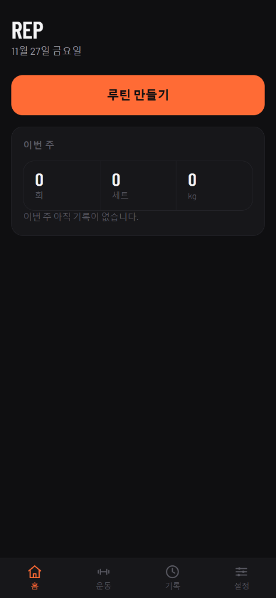
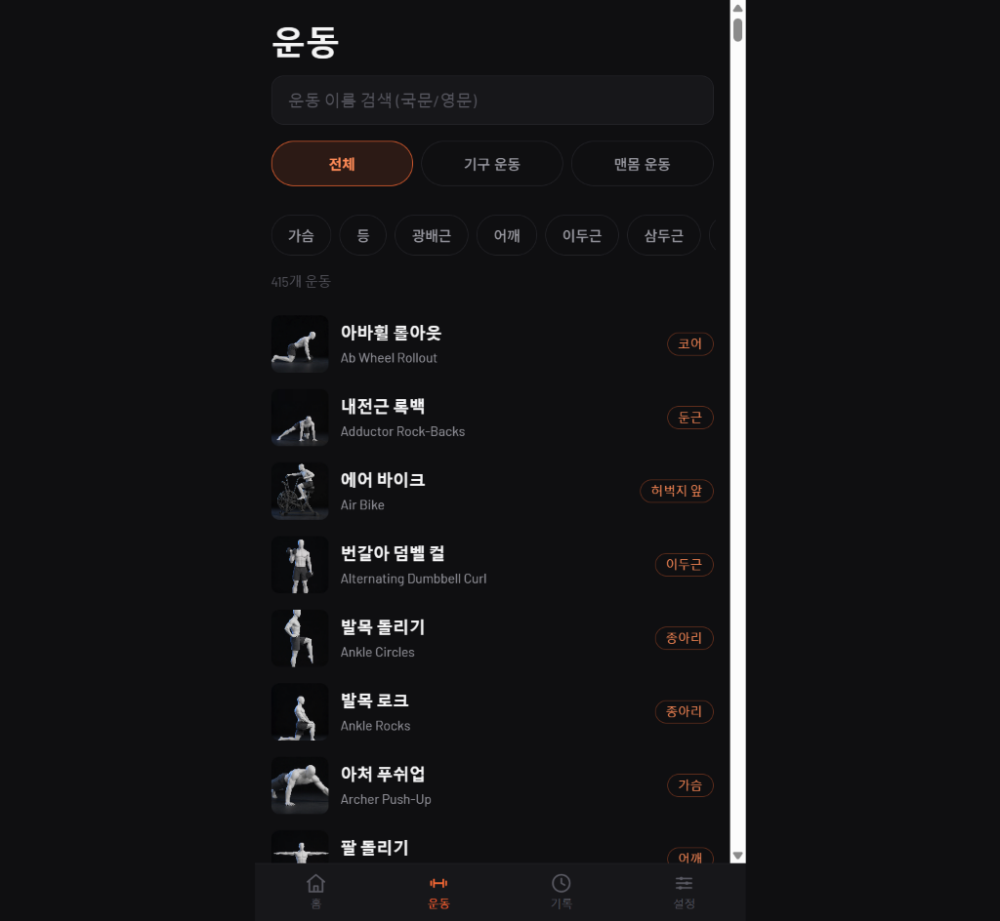
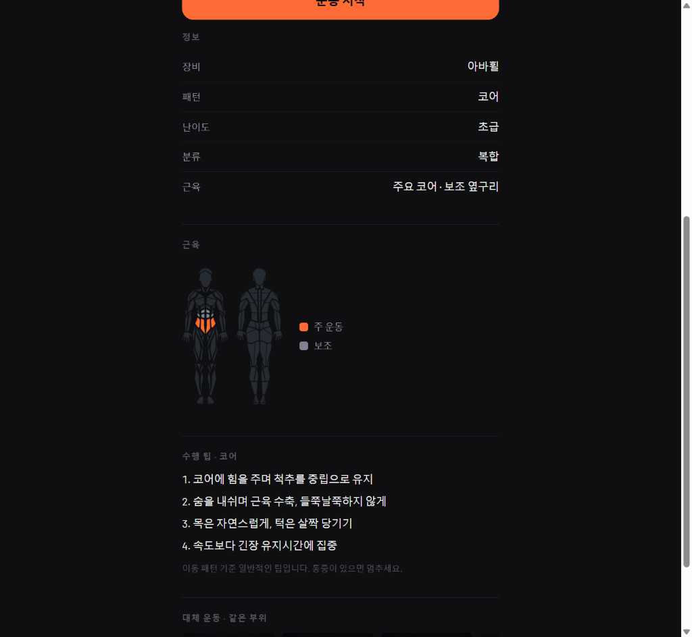

# REP — Offline Workout Tracker PWA

A personal, offline-first strength training tracker built as an installable Progressive Web App (PWA) for iOS Home Screen and mobile browsers.

**Live App:** [https://rep.haki0615.workers.dev](https://rep.haki0615.workers.dev)

> **Project Goal**  
> Built by leveraging **Qwen3.8-27B** alongside specialized **Skills** and targeted fine-tuning (state architecture, offline caching, mobile UX, and edge-case verification) to deliver a clean, production-grade product with zero server dependencies.

---

## Screenshots

| Home | Exercises | Muscle Map |
| :---: | :---: | :---: |
|  |  |  |

---

## How to Install & Use Offline

### iPhone / iPad (iOS Safari)
1. Open **[https://rep.haki0615.workers.dev](https://rep.haki0615.workers.dev)** in **Safari** once while online so the Service Worker caches the app shell and exercise data.
2. Tap the **Share** button (`□↑`) at the bottom of Safari.
3. Select **Add to Home Screen** → **Add**.
4. Launch **REP** from your Home Screen. It runs in standalone full-screen mode and works **100% offline** (even in Airplane Mode).

### Android (Chrome)
1. Open **[https://rep.haki0615.workers.dev](https://rep.haki0615.workers.dev)** in **Chrome**.
2. Tap the **⋮** menu → **Add to Home screen** / **Install app**.

### Desktop (Chrome / Edge)
1. Visit **[https://rep.haki0615.workers.dev](https://rep.haki0615.workers.dev)**.
2. Click the **Install** icon in the address bar (or use it directly in the browser).

> **Tip:** All workout logs, routines, favorites, and settings are stored locally in your browser's IndexedDB. Use **Settings → JSON 내보내기 / JSON 복원** to back up or transfer your data between devices.

---

## Features

- **100% Offline PWA**: Workbox Service Worker precaches the app shell and exercise master dataset (`exercises.json`), with on-demand `CacheFirst` caching for exercise illustrations.
- **Local-First Storage (IndexedDB)**: Workouts, sets, routines, favorites, rest timers, and preferences are persisted locally via `idb` — no account or backend required.
- **Routines & Smart Prefill**: Create, edit, reorder (drag & drop), and swipe-to-delete routines. Automatically prefills set counts, weights (`kg`/`lb`), reps, and per-exercise rest durations from your most recent session.
- **Rest Timer & Global RestBar**: `endTime`-based timer that stays accurate across backgrounding, paired with a persistent bottom `RestBar` across tabs.
- **Exercise Library & Muscle Map**: Bilingual search (Korean/English), equipment and muscle-group filters, substitute exercise suggestions, and interactive SVG muscle highlighting via `@emmorts/body-muscles`.
- **JSON Backup & Restore**: Export and restore your entire workout database as a single JSON file.

---

## Tech Stack

- **Frontend**: React 19, TypeScript, React Router (`HashRouter` with keep-alive tabs)
- **Storage & PWA**: `idb` (IndexedDB), `vite-plugin-pwa` (Workbox)
- **Tooling & Tests**: Vite, Oxlint, Vitest (`jsdom` + `fake-indexeddb`)

---

## Getting Started

```bash
npm install
npm run dev      # Start local dev server
npm run lint     # Run linter (oxlint)
npx vitest run   # Run test suite (93 tests)
npm run build    # Build production bundle (dist/)
```

---

## Deployment (Cloudflare Pages / Workers)

Since REP is a purely static PWA, it can be deployed with zero watermarks on Cloudflare via **GitHub integration** or **Direct Upload**:

- **Build command**: `npm run build`
- **Build output directory**: `dist`

---

## Third-party Credits

- **@emmorts/body-muscles v2.1.1** — SVG muscle illustration map (`src/components/MuscleMap.tsx`)
  - License: Apache-2.0 (see `node_modules/@emmorts/body-muscles/LICENSE` and `NOTICE`)
  - Copyright: EmMorts (fork of `vulovix/body-muscles`)
